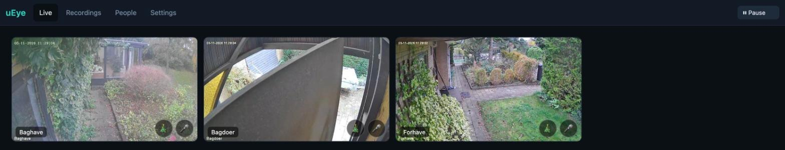
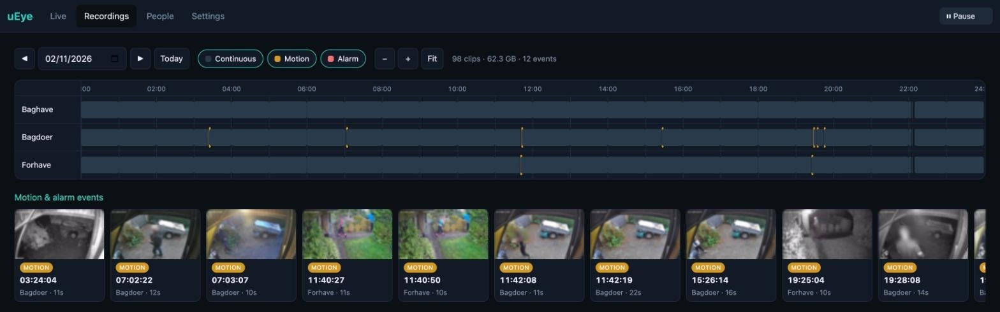
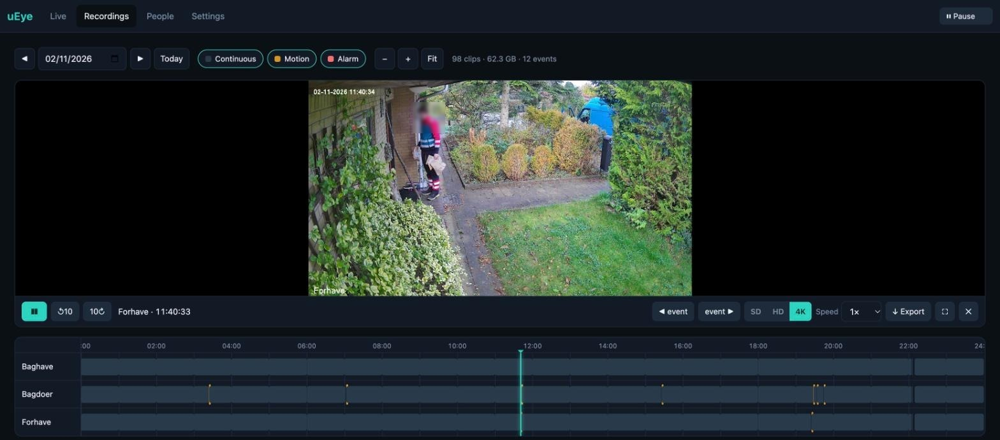
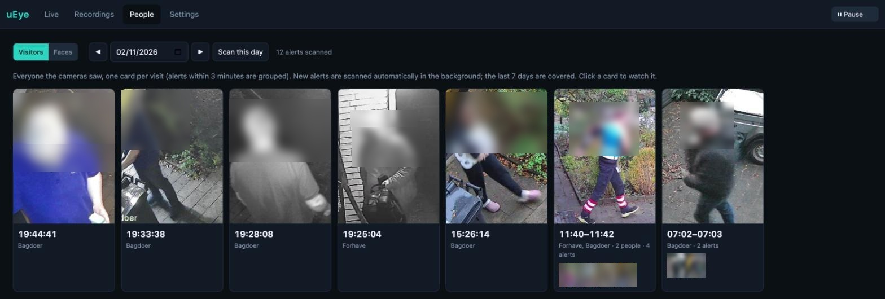
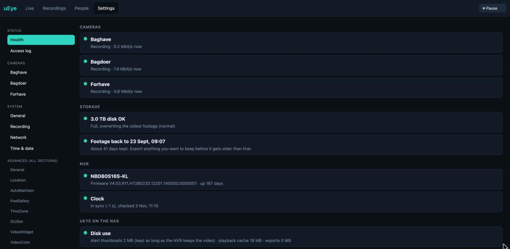
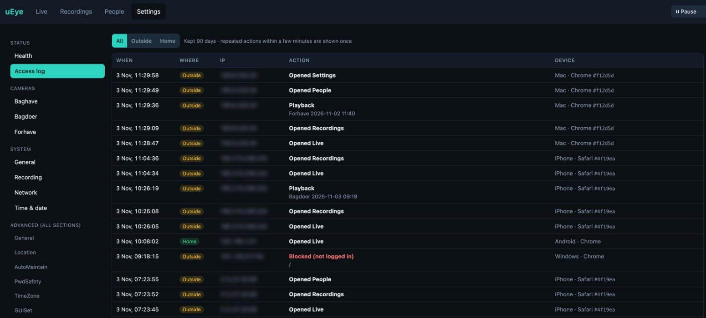

# uEye

A self-hosted replacement for the XMEye app for Xiongmai-family NVRs/DVRs.
One Docker container, one web port, no vendor cloud. Live grid, a recordings
timeline with in-browser playback and export, a "who came by" view, two-way
talk to the cameras, a pause switch, health and access log,
and camera/motion-detection config, all by talking the device's own LAN
protocol (DVRIP / "Sofia", TCP 34567). Responsive: works on phone, tablet and
desktop.

## Screenshots

Taken from the running install (3 Nov 2026). Faces are blurred and IPs in the access log hidden.



| Recordings timeline + event rail | Playback |
| --- | --- |
|  |  |

| People: who came by | Settings: health |
| --- | --- |
|  |  |



## Features

**Live**
- Grid of all cameras (low-res sub stream, MSE with WebRTC fallback). Streams stop when you leave the tab.
- Two-way talk: hold the mic button to talk through the camera speaker, or play a seasonal sound (🎄, 🎃 etc. follow the calendar).
- **⏸ Pause** (top bar, every page): stop recording and motion alerts for 1 h to 2 days, or until 07:00. A banner shows when it ends, with +1h and Resume. The NAS turns everything back on by itself at the end, also after a restart, and puts back exactly the settings that were there before.

**Recordings**
- 24 h timeline per camera, zoomable, with continuous / motion / alarm filters and hover previews.
- Event rail with a thumbnail per alert. Thumbnails are made in the background ahead of time and kept exactly as long as the NVR keeps the video (about 40 days here), so the rail loads instantly.
- Playback in the browser: SD / HD (transcoded on the NAS) or 4K (original stream, fastest start), speed 0.5x to 4x, jump 10 s, previous / next event. Clips start in about 3 to 5 s. Works in iPhone Safari.
- Export a range (up to 30 minutes) as an MP4 download.

**People**
- **Visitors:** a person detector (YOLOX, CPU) checks every alert, so it finds people from behind, under a hood or carrying a parcel. Alerts within 3 minutes are grouped into one visit with the best shot on top. Click to watch.
- **Faces:** faces from those frames are grouped by person (YuNet + SFace). Groups of the same person merge automatically; anything left over can be merged by hand with *Merge into*.
- New alerts are scanned in the background within about 5 minutes, and the last 7 days are kept filled in.

**Settings**
- **Health:** each camera (online, recording, bitrate), disks, how many days of footage are kept, NVR model / firmware / uptime, clock, and uEye's own disk use. A two-step *Reboot NVR* button for when the NVR stops serving playback.
- **Access log:** who opened what, from home or outside, which device, kept 90 days. Logins, failed logins, blocked requests, playback, exports, talk, pauses and setting changes are all in there.
- Per camera: motion detection on / off, sensitivity, and a paintable motion zone grid.
- Every NVR config section, editable as a form (advanced).

**Behind the scenes**
- The NVR has no internet (firewalled), so uEye keeps its clock right: checked hourly, corrected when it drifts more than 2 s.
- Background work (thumbnails, person and face scans) runs on one low-priority thread, about 1 core at most while busy.
- Installable as an app on the iPhone home screen (PWA).

## Why this design

The XMEye app is a thin Java shell over a native `libFunSDK.so`. Two ways it
reaches a recorder:

- **DVRIP over the LAN (port 34567)**: an openly documented protocol. This
  app speaks it directly. Clean, no dependencies.
- **P2P cloud by device serial**: proprietary native code that routes through
  Xiongmai servers (`mi.xmeye.net`, `*.secu100.net`). We deliberately **don't**
  use it: it would mean depending on their cloud, the opposite of the goal.

Remote access, when you want it, is your own problem to solve cleanly: reach
the NAS through a VPN (Tailscale/WireGuard) rather than exposing the NVR to the
internet. (Exposing these recorders directly is exactly how they get botnetted.)
The NVR itself stays LAN-only; only uEye is reachable from outside, behind a login.

```
 Unraid container (one port, 8080)
 ┌───────────────────────────────────────┐
 │ Caddy  ──/────────────▶ web UI         │
 │        ──/api/*───────▶ FastAPI ──┐    │
 │        ──/go2rtc/*────▶ go2rtc ─┐ │    │        LAN
 │                                 │ └────┼──DVRIP──▶ NVR :34567
 │                   dvrip:// ◀────┘      │   (recordings, config)
 └───────────────────────────────────────┘
      live video (go2rtc)  ▲
      recordings + config  ┘ (FastAPI, backend/dvrip.py)
```

## Login (important)

DVRIP LAN login uses the **device-local user**, not your XMEye *cloud* account.
On these recorders that's almost always `admin` plus the password set on the box
itself. Your XMEye *cloud* username is for the P2P path we don't use, so it will
**not** work for the LAN login. Put the device-local credentials in `config.yaml`.

How login works: TCP connect to `:34567`, send a `LOGIN_REQ` (id 1000) with
`{"EncryptType":"MD5","LoginType":"DVRIP-Web","UserName":...,"PassWord":<sofia-hash>}`,
get back `{"Ret":100,"SessionID":"0x..."}`, then echo that SessionID on every
later command. The password is the Xiongmai "sofia hash" (MD5 → base62, 8 chars);
see `backend/dvrip.py` (verified against the canonical `""` → `tlJwpbo6`).

## Quick start (Unraid)

1. Copy `config.example.yaml` to `config.yaml` and set your NVR IP, the
   device-local username/password, and your channels.
2. Build and run:
   ```bash
   docker compose up -d --build
   ```
   (or build the image and add a container in the Unraid UI: port `8080`,
   mount your `config.yaml` at `/config/config.yaml`.)
3. Open `http://<nas-ip>:8080`.

## Outside access + iPhone app

- **At home** (private/LAN IPs) there is no login.
- **From outside** (through a reverse proxy like Nginx Proxy Manager that sends
  `X-Real-IP`) everything is behind a login page. Set `auth.password` in
  `config.yaml`; with no password, outside access is refused. Sessions last 180
  days; delete `/config/auth_secret` to log every device out. 5 wrong passwords
  per IP locks that IP out for 15 minutes.
- go2rtc's own API (which shows the NVR URL incl. password) is blocked from
  outside even when logged in; only the live-video endpoints the UI uses pass.
- **iPhone:** open the site in Safari → Share → *Add to Home Screen*. It runs
  full screen with its own icon. No App Store / developer account needed.

## Tested on

A Xiongmai NBD80S16S-KL with three PoE cameras, running on an Unraid NAS behind
Nginx Proxy Manager. Offline unit tests in `backend/tests/` cover the Sofia
login hash (canonical vector), DVRIP packet framing, config loading, go2rtc
config generation and the seasonal sounds.

Note: config shapes like `Detect.MotionDetect` vary by firmware; they're handled
generically but your box may differ.

## Layout

```
backend/dvrip.py         DVRIP protocol client (login, config, file search, playback, talk, reboot)
backend/main.py          FastAPI app: live, recordings, clips, export, thumbnails, people, health, settings
backend/auth.py          outside login (session cookie, lockout)
backend/accesslog.py     access log (SQLite, 90 days)
backend/pause.py         pause all cameras for a while, resume by itself
backend/persons.py       person detection (YOLOX via OpenCV DNN)
backend/faces.py         face detection + recognition (YuNet + SFace)
backend/faceindex.py     face store, grouping and merging
backend/visitorindex.py  visitor store (who came by, best shot per alert)
backend/audiogen.py      talk audio: G.711 a-law encode + synthesized sounds
backend/seasons.py       which talk sound fits today's date
backend/config.py        config.yaml loader
backend/go2rtc_gen.py    generates go2rtc.yaml (dvrip:// per channel)
backend/tests/           offline protocol tests
web/                     single-page UI (live / recordings / people / settings)
Caddyfile run.sh         single-port front door + process supervisor
Dockerfile docker-compose.yml
```

## Roadmap

- PTZ controls (protocol primitive `DevPtzControl` / id 1400 is confirmed present).
- Live motion-event feed (alarm channel, id 1504).
- Per-camera alarm/siren trigger.
